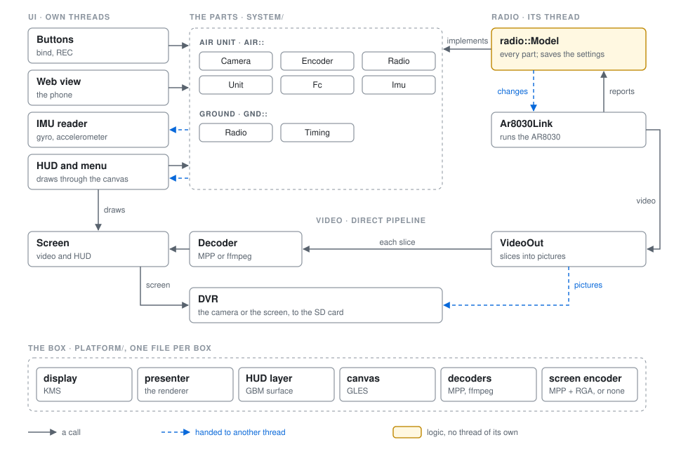

# kestrel-gnd

The ground application of **fpvOS** — what you actually look at through the
goggles. It decodes the link, draws the HUD and the menus, and records.
C++ on DRM/KMS with FFmpeg or Rockchip MPP, rendering straight to the display
controller: no X11, no Wayland, no compositor.

Built and packaged by [fpvOS](https://github.com/gehee/fpvOS), which supplies the toolchain, the
kernel and the root filesystem. This repository is only the application.

```
kestrel-gnd ──libar8030_client.so──► TCP 127.0.0.1:50000 ──► /ar8030soc/daemon
                                                                   │ usbfs
                                                             AR8030 baseband
                                                                   │ RF
                                                                air unit
```

Baseband sockets, slot 0: port 3 video, port 2 control + telemetry (`FE A5`
sky protocol, MSP teed off the same stream).

---

## Features

**Video** — H.265 and H.264, hardware decode through RK MPP on the device
(VAAPI or FFmpeg elsewhere), DRM/KMS output straight to a plane. Variable
refresh rate unless `--disable-vrr`. Screen mode overridable with
`--screen-mode 1920x1080@120`.

**OSD** — a separate DRM plane, so `--no-osd` leaves the video path untouched.
Five menu tabs: VIDEO, RF LINK, HUD, PHYSICS, SYSTEM. Latency panel, link stats (SNR, MCS, frequency, bandwidth, gain), TX power,
LDPC error ratio, FPS/bitrate, and a Betaflight MSP grid fed from the telemetry
socket.

**Radio control** — channel, bandwidth, MCS, TX power, LNA mode and frequency,
plus camera settings pushed to the air unit over the `FE A5` sky protocol.

**DVR** — recording is on the REC button; files land in `dvr_dir`
(default `/media/dvr`). `--dvr-format raw|mp4|fmp4`, `--dvr-framerate N`.
Screen recording rebuilds each frame from what the display scanned out - the
decoded picture and the OSD, blended with the RK3568's RGA - and encodes it on
the VEPU at 60 fps, without touching the display, so the live picture loses
nothing to it (`screen_tap.hpp`). It needs RKMPP and librga; without them there
is no screen recording, and the log says so.

**Settings** — `kestrel-gnd.yaml` next to the binary.

---

## Architecture



The parts of the system - the air unit's camera, its encoder, its radio, the
unit itself, our radio, the pictures' timing - are interfaces (`system/`).
The menu, the buttons and the web view call the parts they set; the HUD and
the IMU reader read the parts they show. None of them knows what carries a
part: the radio's model implements every one today. Only the video goes
around them, for latency.

- **A part** (`system/part.hpp`) has a state, read from any thread without
  waiting, with a version that counts its changes, and one watcher, woken
  when it changes. A change asked of it (`set_max_mcs()`, `set()` on the
  camera...) comes back as a `Ticket`: its number in the order every change
  was asked, and the value as the part will hold it. A part that sends
  something as it comes (the FC's bytes, the IMU samples, the channel scan,
  the video rate) has `take()`, in order, for its one reader.
- **The parts** are in `system/air/` (`Camera`, `Encoder`, `Radio`, `Unit`,
  `Fc`, `Imu`) and `system/gnd/` (`Radio`, `Timing`); the HUD is handed them
  as `hud::Parts`. What crosses threads is the implementation's business:
  the hand-offs are in `base/bus.hpp` - a seqlock slot for a state, a ring
  for a stream, a futex waker - and no caller sees them.
- **`radio::Model`** (`radio/model.hpp`) implements the parts the radio
  carries: each part's state from what the radio reports, the logic that is
  the link's rather than the chip's (the distance less HUD > Calib
  Distance's offset, per air unit), and the changes asked - normalized, the settings
  among them saved as they are asked, numbered and queued for the radio. No
  thread of its own: the radio's threads and the askers run it.
- **`radio::Link`** (`radio/link.hpp`) is what any radio is: `run()`,
  `apply()` for each change, between its steps, and `held()`; nothing else
  is called on it from other threads. **`Ar8030Link`** (`radio/ar8030_link`)
  is the one there is, made from an `Ar8030Config`
  (`radio/ar8030_config.hpp`) that `main()` fills from the settings file and
  the command line. It reads the air unit's packets and reports to the
  model; it writes the FC's bytes, with where a new session starts, and the
  IMU samples read out of the video's SEI into the model's feeds
  (`radio/streams.hpp`); and the video.
- **`radio::VideoOut`** (`radio/video_out.hpp`) is any radio's video out:
  slices into pictures in the pool (`base/video_pool`), the parameter sets
  checked and kept, the decoder fed each slice as it lands - a direct
  call, slice-timed decoding waits on nothing - and each picture to the
  video sinks, marked whole or not by the air unit's slice numbers (each
  slice's header says which it is, and which is the last). The radio tells
  it each picture's capture, by its clock.

**Changes in.** The radio carries out the changes asked of its parts between
its steps, in the order they were asked, so its settings have one writer.
The menu shows what it asked until the part's state says that change was
taken (`hud::link_view`, a function of the parts' states and the tickets). A
setting the radio loads with (its firmware, a stock radio's bandwidth cap)
restarts it, from the radio thread. The REC button is not the radio's: it
starts and stops the DVR directly.

**What the parts hold and send.**

| Part | What it holds or sends | Who reads it |
|---|---|---|
| `gnd::Radio` | the link's figures (SNR, MCS, rates, frequency, distance), its settings as held, the RF controls it accepted, the pairing window; the channel scan's samples and the video received each second, every one | the HUD, woken |
| `air::Radio` | the air unit's TX power (as chosen and as it runs), its power levels | the HUD, woken |
| `air::Encoder` | the cap on its bitrate | the HUD, woken |
| `air::Unit` | what it is (AIR UNIT > INFO: versions, board, sensor, capabilities), its state (in standby or not, temperature), its standby mode as it reports it | the HUD, woken |
| `air::Camera` | its settings and video mode as it reports them, each report counted, so the menu follows it once | the HUD, woken |
| `gnd::Timing` | each picture's air delay and reassembly | the HUD, not woken |
| `air::Imu` | the air unit's gyro and accelerometer (kestrel-air `--imu`), with the camera's angle in order | the IMU reader (`motion/imu_reader`), which integrates them on its own thread |
| `air::Fc` | the FC serial bridge: the flight controller's MSP bytes, with where a new session starts | the HUD, woken when they start coming, taken every 33 ms |

**The box.** What is hardware - the display and what puts the pictures on
it, the HUD's layer on it, what the HUD draws with, the decoders, the
screen's encoder and compositor - is made by the platform
(`platform/platform.hpp`), a file per box: `main()` asks it for each and
hands on what it gets as interfaces (`display::Display`,
`display::Presenter`, `display::HudLayer`, `render::Canvas`, `Vdec`,
`hal::ScreenEncoder`), and nothing else names a backend - the `layers` test
fails on a GL, EGL, GBM or DRM header, or a backend's own, in the HUD, the
recorder or the web view. Another box, with another display, GPU or decoder,
is another file there.

**Drawing.** The HUD draws through `render::Canvas` and nothing else: the
frame and its clip, the shapes, images (made, updated, freed), video
pictures taken as the decoder hands them over, the pixel-space pieces of
the pages and the gallery, a copy of the frame and a layer drawn once and
kept. `CanvasGles` (`render/canvas_gles`) is the GPU's: its programs
(`render/gles_2d`), its text cache, its textures. A box without a GPU needs
a canvas of its own - not written yet. Refresh Sync is the display's too
(`display::RefreshSync`, `Display::refresh_sync()` and its setters): the
menu and a screen recording read and set it there, and the display lock's
globals stay inside `display/`.

**Video and the screen.** The decoder's pictures go to the screen, and the
HUD draws on it. VideoOut hands each picture to the DVR, which only queues
it on the radio thread (a reference, or a copy while the pool runs low) for
a thread of its own: it waits for the keyframe a recording starts on - a
flag the radio acts on - repairs what the radio lost, and writes the file.
The repair (`dvr/hevc_repair`) leaves a picture the radio says came whole
as it is, and learns from those the shapes the air unit cuts pictures into
(with intra refresh, a sweep's first picture is cut differently from the
rest); a picture that lost slices gets copies of the picture before where
its shape has slices it lacks, and a lost picture a copy picture. The DVR's screen encoder captures what the screen shows, for a
screen recording and the web view's live feed; the web view's gallery
serves the recordings.

The radio thread does none of its readers' work, and nothing calls into
the radio. It still takes the settings file's lock on rare events (a
Calib Distance offset for a new air unit, a newly paired air unit, a restart).

**Checking the video path.** `video_replay_check FILE` (a PC build with
`-DKESTREL_TESTS=ON`) runs a recorded stream - what `--debug-replay` plays -
through the link's splitter and VideoOut into a fake decoder and a
recording sink, and prints a digest of everything handed out. The same
digest before and after a change: it did not touch what reaches the
decoder or a recording.

---

## Running

```sh
kestrel-gnd --link ar8030 --osd
```

`--link ar8030` is the only supported source: video arrives on baseband slot 0
port 3, control and telemetry on port 2. `kestrel-gnd --help` lists the rest,
including the `--ar8030-*` block for frequency, power, bandwidth and camera mode.

## Binding an air unit

Three ways in, all the same code path: the goggle's **BIND button**, the
**Bind** row at the top of the RF LINK menu, or `--ar8030-pair` at startup. A
banner reports `BINDING...` with a countdown, then `BOUND` with the address it
found, or `BIND FAILED`.

**Both ends have to be in pairing mode at the same time.** This is the whole
trick, and it is easy to lose hours to. The air unit is the access point and
the goggle only listens; a goggle listening alone runs its full window and
reports nothing, however healthy everything else is.

On a Caddx Ascent air unit, pairing mode is **the RED LED**. Hold its bind
button until the LED turns red, then press bind on the goggle. Neither the
blinking green at boot nor the solid green after a short press is pairing
mode, and nothing in the air unit's Linux userland contains pairing code at
all - the button is handled by the radio module itself. The goggle gives you
a two minute window, so the order is forgiving; a second press cancels it.

If a window ends with nothing, the log says which of the two failures it was:
`bind sees slot0 <mac>` means the radio heard an air unit, while no sighting
line at all means it heard silence and the air unit was never in pairing
mode.

Binding does not need to be undone first, and a goggle that already has a
working link will still bind a different air unit. Note also that a paired air
unit re-associates on its own when powered, with no candidate list on the
ground at all, so "it still connects" is not evidence that a bind took.

The result is written to `/factory/user_cfg.json` as a 100-entry ring,
`bb_mac_addr_0`..`bb_mac_addr_99` with `save_candidate_position` pointing at the
next slot, matching the stock format exactly. An address already in the ring is
left alone rather than rewritten. All of them are pushed to the radio as the
candidate list at startup, and `--ar8030-ap-index N` picks which one to
associate with when several are known.

## Source layout

Listed from the bottom up: a folder builds only on the ones listed before it.
Each is a library of its own, `kg_<folder>`, made by `kestrel_module()` in
`CMakeLists.txt` with the folders it is built on; `app/` is the program, on
all of them.

| Folder | What is in it |
|---|---|
| `third_party/` | code from elsewhere, as it came: the MP4 writer (`minimp4.h`), the QR code maker |
| `utils/` | small helpers any folder may use: maths, the message queue |
| `base/` | what every part stands on: the hand-offs between threads (`bus.hpp`) and the picture pool, the settings file (`settings.hpp`), time, the logs and traces, thread scheduling, the frame mode |
| `hal/` | the hardware interfaces (the decoder in `vdec.hpp`, the screen's encoder and compositor in `screen_out.hpp`, the WiFi access point) and their backends: `hal/rockchip/` for the VRX Pro, `hal/ffmpeg/` for the software decoder; which a box uses is its platform's to say |
| `bsp/` | one file of facts per box (`vrx_pro.cpp`, `pc.cpp`), its buttons; `KESTREL_BOARD` picks which one is built in |
| `region/` | time zones, and the channel rules of the country each is in |
| `system/` | the parts of the system as the rest sees them, each an interface (`part.hpp`; `air/`: the air unit's camera, encoder, radio, unit, FC bytes and IMU samples; `gnd/`: our radio, the pictures' timing), and the air unit's power levels (`air/power.hpp`) |
| `render/` | the canvas the HUD draws with (`canvas.hpp`), the GPU's (`canvas_gles`, its programs in `gles_2d`, the text cache), and the GL context |
| `radio/` | its own terms and commands (`radio.hpp`), its model, which implements the parts it carries (`model`), the interface a radio implements (`link.hpp`), its feeds (`streams`) and video out (`video_out`); and the AR8030 radio, the one there is (`ar8030_link`, `ar8030_config.hpp`): the video and control link, the air unit's messages and IMU samples, the bind, the frame clock |
| `motion/` | the IMU reader: the air unit's IMU samples (`air::Imu`), integrated on a thread of its own; quaternions; the camera's tilt |
| `msp/` | the flight controller's MSP OSD and telemetry, Betaflight's glyphs |
| `display/` | the display as the rest sees it (`display.hpp`: the screen and its modes, where the picture sits, the flips, the presenter; `hud_layer.hpp`: where the HUD's frames go), and KMS's (`drm`, and the C helpers in `kms/`), the renderer that puts pictures up, the refresh lock, the screen tap |
| `platform/` | what each box is made of, the one place a backend is named: the box's file (`vrx_pro.cpp`, `pc.cpp`; `KESTREL_BOARD` picks it, as for `bsp/`) makes its decoders and its screen's encoder and compositor, and says what it can do (`caps`); a box with KMS and a GPU gets its display, presenter and HUD layer from `kms_gles.cpp` and `gles_hud_layer` |
| `dvr/` | recording (the DVR's video sink), the recordings library, repairing a recording |
| `hud/` | the HUD: the OSD (`osd*`: its thread, its images, the frame, the menu's rows and keys), its screens (`hud_*`: the idle screen, the top strip, the lock, the arena and canopy styles, Betaflight's canvas, the menu), the channel page, the gallery (`gallery*`, `osd_gallery`), the parts it is handed (`parts.hpp`) and the link's settings as the menu shows them (`link_view`) |
| `web/` | the phone view's web server |
| `app/` | `main` and the startup wiring: the one place that knows every part |

Each part that keeps settings declares them in its `settings.hpp`: each
one's key in the settings file, its type and its default, once (the
`settings_keys` test fails on a key declared twice). `main()` makes the
settings file and hands it to the parts that keep settings; they read and
write it only through those declarations, so a part can name its own
settings and those of the parts below it, and no others.
| `icons/` | icons |
| `splash/` | the boot splash program |
| `tools/test/` | unit tests (`-DKESTREL_TESTS=ON`); `tools/vdec_test.cpp` is a by-hand decoder test, not built |
| `tools/bench/` | `bus_bench` (`-DKESTREL_BENCH=ON`): a recorded stream through the old and the bus paths, and what each costs the radio thread |
| `docs/` | the architecture diagram |

## Building

```sh
cmake -S . -B build -DKESTREL_HAL=rockchip && cmake --build build -j
```

### Build options

`KESTREL_HAL` picks the set of hardware backends: `rockchip` for the VRX Pro
(MPP decoder, RGA, the VOP2 display lock), or `pc` for a host build with the
ffmpeg decoder. `-DUSE_RKMPP=ON`, which older fpvOS releases pass, still
means `rockchip`.

`KESTREL_BOARD` picks the box: `vrxpro` (the default with `rockchip`) or
`pc` (no buttons, no ADC; the default otherwise, and only with `pc`). Each
box's facts are one file in `bsp/`, and its backends - display, HUD layer,
decoders, screen encoder - one in `platform/`; only the chosen box's files
are compiled in: fpvOS builds one image per box, so nothing is detected at
run time.

Features are switched at build time, so a box that can't run one doesn't
carry its code. fpvOS sets them from its Kconfig options, one set per board:

| Option | Default | What it adds |
|---|---|---|
| `KESTREL_GLES` | on | draws the HUD, menu and gallery with GLES; required until there is a CPU canvas |
| `KESTREL_STREAM_DECODE` | on with `rockchip` | per-slice decode, early presentation and the per-half presenter |
| `KESTREL_SCREEN_ENC` | on with `rockchip` | screen recording and the phone view's encoder |
| `KESTREL_WIFI` | on | the WiFi access point (off: the menu says the system has none) |

The choices are in the generated `kestrel_gnd_features.h`, every one defined
to 0 or 1.

### Tests

```sh
cmake -S . -B build -DKESTREL_TESTS=ON && cmake --build build -j && ctest --test-dir build
```

The unit tests are in `tools/test`, one program each, exiting non-zero on a
failure, linked to the library of the part each one tests. Built with the
device toolchain they run on the unit as they are: copy them over and run
each one. None of them touches the hardware.

`hud_shot OUTDIR [STYLE]` (a PC build with `-DKESTREL_TESTS=ON`) draws the
HUD's screens on the PC's GPU, with no display: the idle screen, the HUD in
each style, every tab of the menu, the channel page, and - given a folder of
recordings (`HUD_SHOT_DVR`) - the gallery, from parts of its own (fakes of
the link's and the air unit's, no radio) and keys; `HUD_SHOT_ASSETS` gives
the idle screen a background image. The gallery's live and stats screens
chart this run's timing, so they differ a little between runs; the rest do
not. It writes each screen as a PNG with a digest of
its pixels. The digests are this machine's, so it is for a change to how the
HUD is drawn that should change nothing: run it before and after, and compare.

The `layers` test (`tools/check_layers.cmake`, on the build host) keeps the
parts in their order: it fails on an include from a part that is not below
the one including it, on a library using a function or variable defined in
a part above it, and on parts built on each other in a circle.

### Cross-compiling for the VRX Pro

The toolchain and sysroot live in fpvOS, not here. Build through it, and it
will fetch this repository at the revision fpvOS pins - a **release tag** once
there is a release, and a commit until then:

```sh
make -C buildroot BR2_EXTERNAL=$PWD/br-external kestrel-rebuild
```

While working on kestrel you do not want that fetch. Point the package at
your checkout and Buildroot compiles your working tree instead, skipping the
download entirely:

```sh
make -C buildroot BR2_EXTERNAL=$PWD/br-external KESTREL_OVERRIDE_SRCDIR=/path/to/kestrel
```

Work lands on `main`, and fpvOS pins the commit it has been built and tested
with. A release is cut by `scripts/release.sh` in fpvOS, which tags that
pinned commit here and pins the tag - so both repositories carry the same
version number and an fpvOS release builds to the same thing forever, offline
included. There is no release branch; the tag is the release. To build a
branch's current head instead of the pin, without a local checkout, pass
`KESTREL_BRANCH=main` to make.

`KESTREL_HAL=rockchip` is required for the device: it pulls in the Rockchip
decoder and the hardware encoder used by screen recording. Linking also needs
`libar8030_client.so`, the radio client library. fpvOS builds it from
ar_libre's `lib/`; for a host build, build that library with the host
compiler and pass it as `-DAR8030_LIB=/path/to/libar8030_client.so`.

## Third-party code

kestrel-gnd is GPLv3 ([LICENSE](LICENSE)). It carries two pieces under their
own licences, unchanged:

- `third_party/qrcodegen.c`, `third_party/qrcodegen.h`: the QR Code generator library by
  Project Nayuki (<https://www.nayuki.io/page/qr-code-generator-library>),
  MIT License. It draws the QR codes on SYSTEM › WiFi AP that join a phone to
  the goggle's network and open the spectator page. The licence text is at
  the top of both files.
- `include/rga/`: the im2d API headers of Rockchip's librga, Apache License
  2.0 (see [include/rga/README.md](include/rga/README.md)).

## Software HUD development

The Ascent software frontend from the development branch lives in `hud/lvgl/`.
It preserves the LVGL 9.2.2 Canopy and Vector renderers, perspective text, menu
controller, preferences, cropped HUD buffers and optional renderer worker.
Projection helpers live in `render/software/`; flight values are shared with
MSP through `system/flight_telemetry.hpp`. The frontend accepts normalized state
and does not own the native radio or decoder.

Build and test the frontend independently of DRM, GLES, FFmpeg and the radio SDK:

```sh
cmake -S . -B .local/build-lvgl -DKESTREL_LVGL_TOOLS_ONLY=ON -DKESTREL_TESTS=ON
cmake --build .local/build-lvgl -j
ctest --test-dir .local/build-lvgl --output-on-failure
```

`KESTREL_LVGL_SOURCE_DIR` selects an existing LVGL 9.2.2 checkout for offline
builds. Without it, CMake fetches the pinned commit. Generate 1080p panel masks
with `kestrel-ui-assetgen 1920 1080 ASSETS`, and the font with
`python3 tools/ui_font_bake.py FONT.ttf ASSETS/canopy-font.kuf`. Use the original
Chakra Petch SemiBold font and retain its OFL licence alongside the generated
atlas. Configure `KESTREL_UI_TEST_ASSETS` with the absolute asset directory to
also run rendering and HUD worker/recovery tests.

Native Ascent AR9311 build instructions and current hardware-validation limits are in [docs/ascent.md](docs/ascent.md).
